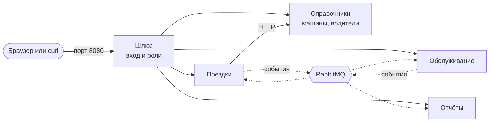

# АСУ «Автопарк»

Учебный проект: автоматизированная система управления автопарком на микросервисной архитектуре.

Автор: Ленец Е.

Система ведёт учёт машин и водителей, выпускает машины в поездки и следит за правилами:

- водитель не может вести две машины одновременно;
- после каждой поездки машине нужно обслуживание, без него её не выпустить;
- обслуживание проводится только в будни с 8:00 до 17:00;
- водителю нельзя дать машину, на которую нет категории в правах.

## Документы

| Что | Где |
|-----|-----|
| Бизнес-требования, правила, риски, критерии приёмки | [REQUIREMENTS.md](REQUIREMENTS.md) |
| UML-диаграммы вариантов использования | [docs/diagrams](docs/diagrams) (картинки показаны в конце REQUIREMENTS.md) |
| Архитектура: сервисы, события, принятые решения | [docs/architecture.md](docs/architecture.md) |
| Как использовался ИИ-агент | [docs/ai-agent.md](docs/ai-agent.md) |

Код сгенерирован ИИ-агентом (Claude Code) по требованиям из `REQUIREMENTS.md`.

## Из чего состоит



Пять сервисов на Python (FastAPI), у четырёх из них своя база в PostgreSQL, события идут через RabbitMQ.
Подробности — в [docs/architecture.md](docs/architecture.md).

## Запуск

Нужен только [Docker Desktop](https://www.docker.com/products/docker-desktop/).

```bash
git clone https://github.com/qqZeR002/avtopark-microservices.git
cd avtopark-microservices
docker compose up -d --build --wait
```

Первый запуск занимает 1–2 минуты. После него:

- веб-интерфейс: <http://localhost:8080>
- состояние сервисов: <http://localhost:8080/api/health>
- панель RabbitMQ (очереди и события): <http://localhost:15672>, вход `autopark` / `autopark_demo`

Остановить: `docker compose down`. Остановить и стереть данные: `docker compose down -v`.

### Учебные пользователи

| Логин | Пароль | Что может |
|-------|--------|-----------|
| `admin` | `admin_demo` | добавлять и списывать машины, добавлять и увольнять водителей |
| `dispatcher` | `dispatcher_demo` | выпускать машины и принимать их из поездок |
| `mechanic` | `mechanic_demo` | начинать и завершать обслуживание |
| `manager` | `manager_demo` | смотреть отчёты |

Пароли учебные. Для настоящей установки скопируйте `.env.example` в `.env` и задайте свои.

## Проверка, что требования выполняются

### Автоматически

Сценарий проходит все критерии приёмки из раздела 10 требований и печатает результат по каждому:

```bash
python3 scripts/check_requirements.py
```

С ключом `--with-outage` он дополнительно останавливает сервис обслуживания, закрывает поездку
и проверяет, что после запуска сервис получил пропущенное событие (КП-13):

```bash
python3 scripts/check_requirements.py --with-outage
```

Фрагмент вывода:

```text
  [OK  ] КП-2: водитель не может вести вторую машину  ->  409: Водитель Иванов И. И. сейчас в поездке на машине 6810 AB-1
  [OK  ] КП-4: водителю категории B не дают грузовик  ->  409: У водителя Сидоров С. С. нет категории C, нужной для машины 6810 AB-2
  [OK  ] КП-6: необслуженную машину выпускать нельзя  ->  409: Машина 6810 AB-1 не прошла обслуживание после прошлой поездки
  [OK  ] КП-7: в субботу сервис не работает  ->  409: Обслуживание проводится только в будни с 8:00 до 17:00, а указано 07.11.2026 10:00
  [OK  ] НФТ-4: из пяти одновременных выпусков одного водителя прошёл ровно один  ->  коды ответов: [201, 409, 409, 409, 409]
  [OK  ] КП-13: после запуска сервис получил пропущенное событие и создал заявку
ИТОГ: все проверки пройдены
```

После сценария в системе остаются его машины, водители и поездки — их удобно посмотреть в веб-интерфейсе.

### Вручную через веб-интерфейс

1. Войти как `admin`, добавить машину категории B и водителя с категорией B.
2. Войти как `dispatcher`, на вкладке «Поездки» выпустить машину. Попробовать выпустить
   того же водителя на другой машине — появится отказ.
3. Нажать «Принять машину», ввести пробег. На вкладке «Машины» состояние станет «ждёт обслуживания»,
   повторный выпуск будет отклонён.
4. Войти как `mechanic`, на вкладке «Обслуживание» нажать «Начать», затем «Завершить».
   Вечером или в выходной система откажет; тогда в поле «Время действия» нужно указать
   рабочее время, например ближайший прошедший будний день в 10:00.
5. Войти как `dispatcher` — машину снова можно выпустить.
6. Войти как `manager`, на вкладке «Отчёты» выбрать период.

### Вручную через curl

```bash
# вход: получаем токен диспетчера
TOKEN=$(curl -s localhost:8080/api/login -H 'Content-Type: application/json' \
  -d '{"login":"dispatcher","password":"dispatcher_demo"}' | python3 -c 'import sys,json; print(json.load(sys.stdin)["token"])')

# список машин
curl -s localhost:8080/api/fleet/vehicles -H "Authorization: Bearer $TOKEN"

# выпуск машины 1 с водителем 1 (время можно не указывать - тогда текущее)
curl -s localhost:8080/api/trips/trips -H "Authorization: Bearer $TOKEN" -H 'Content-Type: application/json' \
  -d '{"vehicle_id":1,"driver_id":1,"purpose":"Доставка","at":"2026-11-10T09:00"}'

# закрытие поездки 1
curl -s localhost:8080/api/trips/trips/1/finish -H "Authorization: Bearer $TOKEN" -H 'Content-Type: application/json' \
  -d '{"distance_km":42,"at":"2026-11-10T11:00"}'
```

### Основные адреса API

Все запросы идут через шлюз `http://localhost:8080` с заголовком `Authorization: Bearer <токен>`.

| Метод и адрес | Что делает | Роль |
|---------------|------------|------|
| `POST /api/login` | вход, выдаёт токен | — |
| `GET /api/fleet/vehicles?category=C` | список машин | все |
| `POST /api/fleet/vehicles` | добавить машину | admin |
| `PATCH /api/fleet/vehicles/{id}` | списать или вернуть машину | admin |
| `GET`, `POST`, `PATCH /api/fleet/drivers…` | то же для водителей | все / admin |
| `GET /api/trips/trips?status=active` | список поездок | все |
| `POST /api/trips/trips` | выпустить машину | dispatcher |
| `POST /api/trips/trips/{id}/finish` | принять машину | dispatcher |
| `GET /api/maintenance/orders?status=waiting` | очередь заявок | все |
| `POST /api/maintenance/orders/{id}/start` | начать обслуживание | mechanic |
| `POST /api/maintenance/orders/{id}/finish` | завершить обслуживание | mechanic |
| `GET /api/reports/vehicles?from=2026-11-02&to=2026-11-08` | отчёт по машинам | manager |
| `GET /api/reports/drivers?from=…&to=…` | отчёт по водителям | manager |

## Модульные тесты

Правила вынесены в отдельные файлы (`rules.py`, `calc.py`) и проверяются без базы и сети:

```bash
python3 -m venv .venv
.venv/bin/pip install -r requirements-dev.txt
(cd services/trips && ../../.venv/bin/python -m pytest -q)
(cd services/maintenance && ../../.venv/bin/python -m pytest -q)
(cd services/reports && ../../.venv/bin/python -m pytest -q)
```

Модульные тесты и сквозной сценарий также запускаются в GitHub Actions (вкладка Actions).

## Структура репозитория

```text
REQUIREMENTS.md            бизнес-требования, риски, критерии приёмки
docs/
  diagrams/                диаграммы вариантов использования (.puml и .png)
  architecture.md          архитектура и принятые решения
  ai-agent.md              как использовался ИИ-агент
docker-compose.yml         запуск всей системы
postgres/                  создание отдельных баз для сервисов
services/
  gateway/                 шлюз: вход, роли, веб-страница
  fleet/                   справочники машин и водителей
  trips/                   поездки (rules.py - правила выпуска)
  maintenance/             обслуживание (rules.py - рабочее время)
  reports/                 отчёты (calc.py - расчёты)
scripts/
  check_requirements.py    сквозная проверка критериев приёмки
```

Чтобы перерисовать диаграммы после правки `.puml`:

```bash
docker run --rm -v "$PWD/docs/diagrams:/work" -w /work plantuml/plantuml -tpng -charset UTF-8 "*.puml"
```

## Ограничения

Перечислены в разделе 8 требований и в конце `docs/architecture.md`. Главные: праздники не учитываются,
пользователей четыре и они заданы заранее, время события вводит сотрудник.
