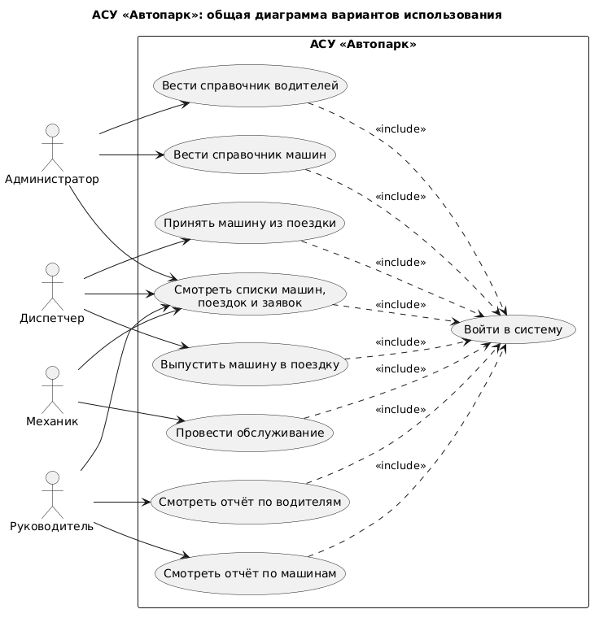
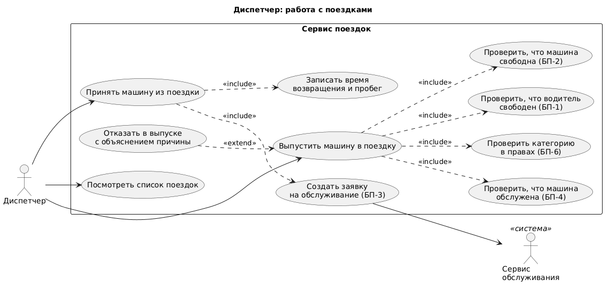
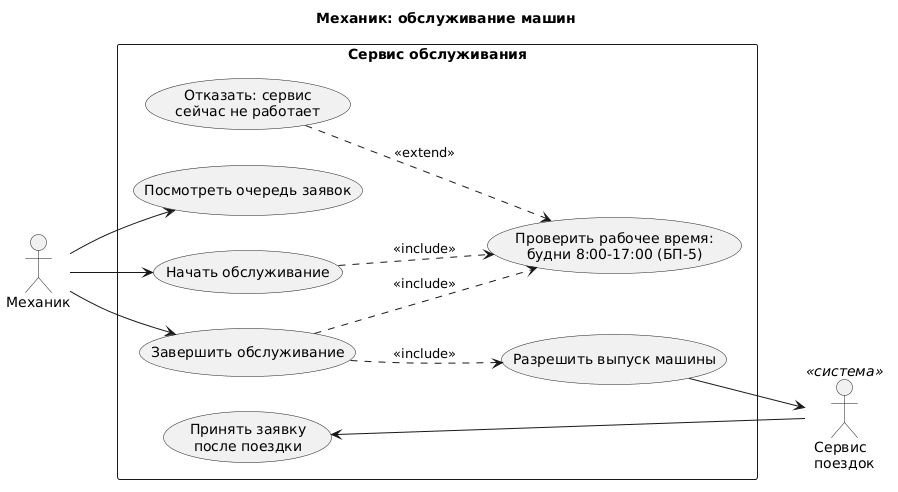
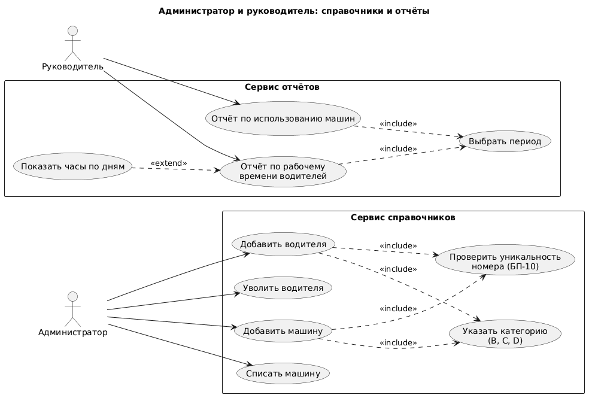

# Бизнес-требования: АСУ «Автопарк»

Автор: Ленец Е.

Документ описывает, какую задачу решает система, кто ей пользуется, что она обязана уметь
и какие есть риски. Именно этот файл вместе с диаграммами из `docs/diagrams` был передан
ИИ-агенту как постановка задачи (подробнее в [docs/ai-agent.md](docs/ai-agent.md)).

## 1. Описание проблемы

В небольшом автопарке предприятия (легковые машины, грузовики, автобусы) учёт ведётся
в бумажном журнале и в таблице Excel. Из-за этого регулярно случаются ошибки:

- одного и того же водителя записывают на две машины в одно время;
- машину выпускают в рейс, хотя после прошлой поездки её не осмотрел механик;
- водителю дают машину, на которую у него нет категории в правах;
- в конце месяца никто не может быстро сказать, сколько часов отработал водитель
  и какие машины простаивают.

## 2. Цели

| № | Цель | Как поймём, что цель достигнута |
|---|------|---------------------------------|
| Ц1 | Исключить выпуск необслуженной машины | Система отказывает в 100 % таких попыток |
| Ц2 | Исключить «раздвоение» водителя | Нельзя открыть вторую поездку, пока не закрыта первая |
| Ц3 | Сократить время на отчёты | Отчёт за любой период строится одним запросом, а не вручную |
| Ц4 | Сделать учёт прозрачным | По каждой поездке и обслуживанию видно, кто и когда их оформил |

## 3. Участники (роли)

| Роль | Что делает в системе |
|------|----------------------|
| Администратор | Ведёт справочники: машины и водители, их категории, списание/увольнение |
| Диспетчер | Выпускает машины в поездку и принимает их обратно |
| Механик | Проводит обслуживание машин после поездок |
| Руководитель | Смотрит отчёты по машинам и по рабочему времени водителей |

## 4. Словарь

- **Категория** — B (легковые), C (грузовые), D (автобусы). У машины одна категория,
  у водителя в правах может быть несколько.
- **Поездка** — использование одной машины одним водителем от выезда до возвращения.
- **Заявка на обслуживание** — задание механику осмотреть машину после поездки.
- **Рабочее время сервиса** — будние дни (понедельник–пятница) с 8:00 до 17:00
  по времени автопарка (часовой пояс Europe/Minsk).

## 5. Функциональные требования

### Справочники
- **ФТ-1.** Администратор добавляет машину: госномер, модель, категория.
- **ФТ-2.** Администратор добавляет водителя: ФИО, номер удостоверения, список категорий.
- **ФТ-3.** Машину можно списать, а водителя уволить (пометка «не активен»); история поездок сохраняется.
- **ФТ-4.** Списки машин и водителей можно отфильтровать по категории.

### Поездки
- **ФТ-5.** Диспетчер открывает поездку: машина, водитель, цель, время выезда.
- **ФТ-6.** Диспетчер закрывает поездку: время возвращения и пробег в километрах.
- **ФТ-7.** Можно посмотреть список поездок с фильтрами по состоянию, машине и водителю.

### Обслуживание
- **ФТ-8.** После закрытия поездки заявка на обслуживание машины создаётся автоматически.
- **ФТ-9.** Механик отмечает начало и окончание обслуживания.
- **ФТ-10.** Можно посмотреть очередь заявок и их состояние.

### Отчёты
- **ФТ-11.** Отчёт по использованию машин за период: число поездок, пробег, часы в поездках,
  часы ожидания обслуживания, часы на обслуживании, загрузка в процентах.
- **ФТ-12.** Отчёт по рабочему времени водителей за период: число поездок, часы за рулём
  всего и по дням, пробег.

### Доступ
- **ФТ-13.** Вход по логину и паролю; каждое действие доступно только своей роли
  (см. раздел 3). Смотреть справочники, поездки и заявки могут все роли, отчёты — только руководитель.

## 6. Бизнес-правила

| № | Правило |
|---|---------|
| БП-1 | Водитель не может вести несколько машин одновременно: пока у него есть незакрытая поездка, новую открыть нельзя |
| БП-2 | Одна машина не может быть в двух поездках одновременно |
| БП-3 | После **каждой** поездки машине требуется обслуживание |
| БП-4 | Машину, не прошедшую обслуживание после последней поездки, выпускать нельзя |
| БП-5 | Обслуживание проводится только в будни с 8:00 до 17:00: и начало, и окончание должны попадать в это время |
| БП-6 | Водитель может вести машину только той категории, которая есть у него в правах |
| БП-7 | Списанную машину и уволенного водителя нельзя назначить в поездку |
| БП-8 | Время не идёт назад: поездка не может закончиться раньше, чем началась; обслуживание не может начаться раньше возвращения машины; новая поездка не может начаться раньше окончания обслуживания |
| БП-9 | Нельзя оформлять события «из будущего»; пробег должен быть больше нуля |
| БП-10 | Госномер машины и номер удостоверения водителя уникальны |

## 7. Нефункциональные требования

- **НФТ-1. Архитектура.** Система состоит из независимых микросервисов, у каждого своя
  база данных. Сервисы не читают чужие базы.
- **НФТ-2. Запуск.** Вся система поднимается одной командой `docker compose up`.
- **НФТ-3. Устойчивость.** Отказ сервиса отчётов или сервиса обслуживания не мешает
  диспетчеру закрывать поездки. Когда сервис вернётся, он получит пропущенные события.
- **НФТ-4. Надёжность правил.** БП-1 и БП-2 выполняются даже при двух одновременных запросах
  (защита на уровне базы данных).
- **НФТ-5. Безопасность.** Снаружи доступен только шлюз; внутренние сервисы и базы
  в сеть компьютера не публикуются. Пароли и секреты задаются через переменные окружения.
- **НФТ-6. Понятные ошибки.** При отказе система отвечает по-русски, какое правило нарушено.
- **НФТ-7. Проверяемость.** Есть автоматический сценарий, который проверяет критерии приёмки.

## 8. Ограничения и допущения

- Один автопарк, одна площадка, один часовой пояс.
- Государственные праздники не учитываются: рабочими считаются все дни с понедельника по пятницу.
- Время события вводит сотрудник (по умолчанию — текущее). Это позволяет внести в систему
  поездку, которая уже состоялась, но не позволяет указать время из будущего.
- Пользователей четыре, по одному на роль; заводить новых через интерфейс нельзя.
- Учёт топлива, штрафов, маршрутов и GPS в задачу не входит.
- Пробег поездки относится к тому периоду отчёта, в который поездка завершилась.

## 9. Риски

| № | Риск | Вероятность | Влияние | Что делаем |
|---|------|-------------|---------|------------|
| Р1 | Сервис обслуживания недоступен, заявки не создаются | Средняя | Высокое | События сохраняются в базе сервиса поездок и в очереди; машина остаётся заблокированной (ошибка в безопасную сторону) |
| Р2 | Два диспетчера одновременно назначают одного водителя | Средняя | Высокое | Уникальный индекс в базе: вторая запись физически не создастся |
| Р3 | Сообщение между сервисами потерялось или пришло дважды | Низкая | Среднее | Отправка через таблицу исходящих событий, обработчики устойчивы к повторам |
| Р4 | Данные в отчётах отстают от реальных | Средняя | Низкое | Отчёты — справочная информация; задержка обычно меньше секунды, это описано в документации |
| Р5 | Сотрудник указал неверное время события | Средняя | Среднее | Проверки БП-8 и БП-9; в записи хранится, кто её оформил |
| Р6 | Справочник машин недоступен в момент выпуска | Низкая | Среднее | Выпуск отклоняется с понятной ошибкой: без проверки категории выпускать нельзя |
| Р7 | Микросервисы усложняют систему по сравнению с одной программой | Высокая | Среднее | Сервисов всего четыре, границы проведены по ролям; запуск одной командой |
| Р8 | Код сгенерирован ИИ-агентом и может содержать ошибки | Средняя | Среднее | Модульные тесты правил и сквозной сценарий по критериям приёмки, запуск в CI |
| Р9 | Утечка демонстрационных паролей | Низкая | Низкое | Пароли только для учебного стенда; в реальной установке задаются через `.env` |

## 10. Критерии приёмки

Каждый критерий проверяется автоматическим сценарием `scripts/check_requirements.py`.

| № | Сценарий | Ожидаемый результат | Правило |
|---|----------|---------------------|---------|
| КП-1 | Диспетчер выпускает свободную машину со свободным водителем | Поездка создана | ФТ-5 |
| КП-2 | Того же водителя назначают на вторую машину | Отказ | БП-1 |
| КП-3 | Ту же машину выпускают с другим водителем | Отказ | БП-2 |
| КП-4 | Водителю категории B дают грузовик | Отказ | БП-6 |
| КП-5 | Поездку закрывают | Автоматически появилась заявка на обслуживание | ФТ-8, БП-3 |
| КП-6 | Вернувшуюся машину сразу выпускают снова | Отказ | БП-4 |
| КП-7 | Механик начинает обслуживание в субботу или в 19:00 | Отказ | БП-5 |
| КП-8 | Механик проводит обслуживание в рабочее время | Заявка закрыта | ФТ-9 |
| КП-9 | Обслуженную машину выпускают снова | Поездка создана | БП-4 |
| КП-10 | Диспетчер пытается добавить машину, механик — открыть поездку | Отказ по правам | ФТ-13 |
| КП-11 | Руководитель строит отчёты за период | Часы и пробег совпадают с введёнными данными | ФТ-11, ФТ-12 |
| КП-12 | Списанную машину назначают в поездку | Отказ | БП-7 |
| КП-13 | Сервис обслуживания остановлен, поездку закрывают, сервис запускают | Поездка закрылась, заявка появилась после запуска | НФТ-3 |

## 11. Диаграммы вариантов использования

Исходники в формате PlantUML лежат в `docs/diagrams/*.puml`, рядом — готовые картинки.

### Общая диаграмма

### Диспетчер: поездки

### Механик: обслуживание

### Администратор и руководитель: справочники и отчёты

