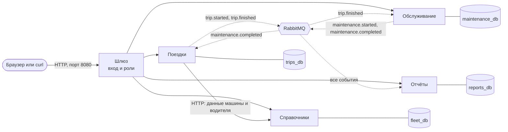
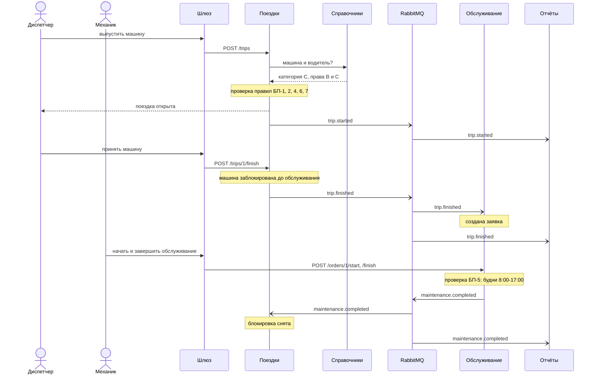

# Архитектура

## Сервисы и их границы

Границы проведены по ролям из требований: у каждой роли «свой» сервис, который можно
менять и перезапускать отдельно от остальных.

| Сервис | За что отвечает | Своя база | Кто им пользуется |
|--------|-----------------|-----------|-------------------|
| `gateway` (шлюз) | Вход, проверка роли, пересылка запросов, веб-страница | нет | все |
| `fleet` (справочники) | Машины, водители, категории | `fleet_db` | администратор |
| `trips` (поездки) | Выпуск и приём машин, правила БП-1, 2, 4, 6, 7 | `trips_db` | диспетчер |
| `maintenance` (обслуживание) | Заявки, правило рабочего времени БП-5 | `maintenance_db` | механик |
| `reports` (отчёты) | Отчёты по машинам и водителям | `reports_db` | руководитель |

Сплошные стрелки — обычные запросы «спросил и сразу получил ответ».
Пунктирные — события: сервис сообщает «у меня произошло то-то», а кому это интересно, тот и реагирует.

## Два способа общения сервисов

**Запрос (HTTP)** используется там, где ответ нужен немедленно. Сервис поездок перед выпуском
спрашивает у справочника категорию машины и права водителя. Если справочник не отвечает,
выпуск отклоняется: выпускать без проверки нельзя.

**Событие (RabbitMQ)** используется там, где можно подождать секунду. Диспетчер закрыл поездку —
сервис поездок публикует `trip.finished`, а сервис обслуживания создаёт по нему заявку.
Сервисы при этом не зависят друг от друга: если обслуживание выключено, поездка всё равно
закроется, а событие дождётся в очереди.

| Событие | Кто публикует | Кто слушает | Что делает слушатель |
|---------|---------------|-------------|----------------------|
| `trip.started` | поездки | отчёты | запоминает начало поездки |
| `trip.finished` | поездки | обслуживание, отчёты | создаёт заявку; запоминает конец и пробег |
| `maintenance.started` | обслуживание | отчёты | запоминает начало обслуживания |
| `maintenance.completed` | обслуживание | поездки, отчёты | снимает блокировку с машины; запоминает конец |

## Главный сценарий

## Решения и почему они такие

**Кто решает, можно ли выпустить машину.** Решает сервис поездок по своим данным: у последней
поездки машины должно стоять время обслуживания. Он не спрашивает об этом сервис обслуживания
в момент выпуска. Поэтому при любом сбое (сервис обслуживания выключен, событие ещё в пути)
машина остаётся заблокированной. Система может ошибиться только в безопасную сторону.

**Таблица исходящих событий (outbox).** Если сначала сохранить поездку, а потом отправить событие,
между этими шагами сервис может упасть, и заявка на обслуживание не появится никогда.
Поэтому событие сначала записывается в таблицу `outbox` той же транзакцией, что и поездка,
а отдельный поток отправляет его в RabbitMQ и помечает отправленным. См. `messaging.py`.

**Повторная доставка.** При таком подходе событие может прийти дважды. Обработчики к этому готовы:
заявка по одной поездке создаётся один раз (уникальный `trip_id`), отчёты перезаписывают
тот же факт, сервис поездок ставит время обслуживания только если оно ещё пусто.

**Одновременные запросы.** Проверки в коде недостаточно: два запроса могут пройти её одновременно.
Поэтому в `trips_db` есть уникальные индексы «одна открытая поездка на водителя» и
«одна открытая поездка на машину». Вторую запись база не примет.

**Копии данных.** Сервис поездок хранит у себя госномер и ФИО на момент выезда, а сервис отчётов —
собственную копию фактов. Так сервисы не ходят в чужие базы, а отчёты строятся,
даже если остальные сервисы выключены.

**Отдельные базы.** Сервер PostgreSQL один (чтобы стенд не занимал много памяти), но у каждого
сервиса своя база и свой пользователь без права подключаться к чужим. В настоящей установке
базы можно разнести по разным серверам, поменяв только строку подключения.

**Безопасность.** Наружу опубликован только порт шлюза. Шлюз проверяет токен и роль и передаёт
сервисам логин в заголовке `X-User`; сервисы записывают, кто оформил действие.

## Что упрощено

- Один экземпляр каждого сервиса, без балансировки.
- Таблицы создаются при старте сервиса, без системы миграций.
- Сервисы доверяют заголовку `X-User`, потому что недоступны снаружи.
- Файлы `db.py`, `timeutil.py`, `messaging.py` скопированы в каждый сервис, а не вынесены
  в общую библиотеку: так сервисы остаются независимыми при сборке.
